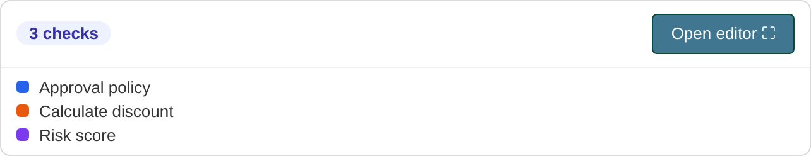
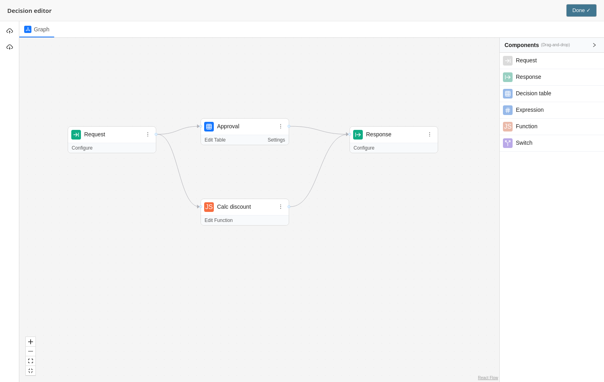

# django-jdm-editor

A Django admin widget for editing **JDM (JSON Decision Model)** graphs from
[GoRules](https://gorules.io) — the visual decision-graph editor
[`@gorules/jdm-editor`](https://github.com/gorules/jdm-editor), wired into a Django
model field. Like `django-json-widget`, but instead of raw JSON you get a full
visual decision-graph editor.

**End users don't need Node/npm** — the editor's JavaScript bundle ships pre-built
inside the wheel.

## Screenshots

A compact summary panel sits in the admin form; clicking **Open editor** expands the
full `DecisionGraph` to a fullscreen overlay:





## Install

```bash
pip install django-jdm-editor
```

Add the app to `INSTALLED_APPS` (it provides static assets and templates):

```python
INSTALLED_APPS = [
    # ...
    "django_jdm_editor",
]
```

## Usage

### Option 1 — `JDMField` (recommended)

```python
from django.db import models
from django_jdm_editor.fields import JDMField


class Policy(models.Model):
    name = models.CharField(max_length=100)
    decision = JDMField(default=dict, blank=True)
```

Register the model in the admin as usual — the field renders the JDM editor
automatically.

### Option 2 — plain `JSONField` + widget override

Keep your existing `JSONField` and attach the widget in the `ModelAdmin`:

```python
from django.contrib import admin
from django.db.models import JSONField
from django_jdm_editor.widgets import JDMWidget
from .models import Policy


@admin.register(Policy)
class PolicyAdmin(admin.ModelAdmin):
    formfield_overrides = {
        JSONField: {"widget": JDMWidget},
    }
```

## Simulation (optional)

Pass `simulate_url` to the widget to enable the in-editor **Simulator** panel.
On run, the editor POSTs `{"graph": ..., "context": ...}` to that URL (with the
`X-CSRFToken` header) and shows the result/trace:

```python
from django.urls import reverse_lazy
from django_jdm_editor.widgets import JDMWidget

class PolicyAdmin(admin.ModelAdmin):
    formfield_overrides = {
        JSONField: {"widget": JDMWidget(simulate_url=reverse_lazy("my-simulate-view"))},
    }
```

Your view receives `{"graph", "context"}` and should return
`{"performance", "result", "trace"}` on success, or `{"error": {"message": ...}}`.
Evaluate the graph however you like — e.g. with [`zen-engine`](https://pypi.org/project/zen-engine/).
Without `simulate_url`, no simulation UI is shown.

## How it works

The widget renders a hidden `<input>` holding the JDM JSON plus a
`<div data-jdm-editor>` container. The bundled JS reads the initial JSON, mounts a
`DecisionGraph`, and writes changes back into the hidden input — so the value
travels with the form like any other field. React is inlined into the bundle, so
it never clashes with other React on the page and needs no importmap. No external
CDNs are contacted (CSP/offline friendly).

Run `collectstatic` as usual to serve the assets.

## Development

The JS lives in `frontend/` and is built with Vite into
`src/django_jdm_editor/static/django_jdm_editor/`:

```bash
cd frontend
npm ci
npm run build
```

Python tests:

```bash
pip install -e ".[dev]"
pytest
```

### Packaging

By default (**variant A**) the JS bundle is **not** committed to git — it is built
in CI at release time and packed into the wheel. The hatchling build hook
(`hatch_build.py`) builds it automatically when Node.js is present and fails the
build if the assets are missing, so a wheel can never be published without the
editor. End users installing from PyPI or a built wheel therefore need **no
Node.js**; only installing straight from git (`pip install git+…`) requires Node
so the hook can build the bundle on the fly.

To switch to **variant B** (commit the built bundle into git — enables
`pip install git+…` without Node):

1. Remove `jdm-editor.js` / `jdm-editor.css` from
   `src/django_jdm_editor/static/django_jdm_editor/.gitignore` and commit the
   built bundle.
2. Replace the build hook so it only verifies the assets exist instead of building
   them.
3. Add a CI job that rebuilds the bundle and fails if `git diff` on `static/` is
   non-empty (guards against the committed bundle drifting out of sync).

The rest of the repository layout stays the same.

## License

MIT
